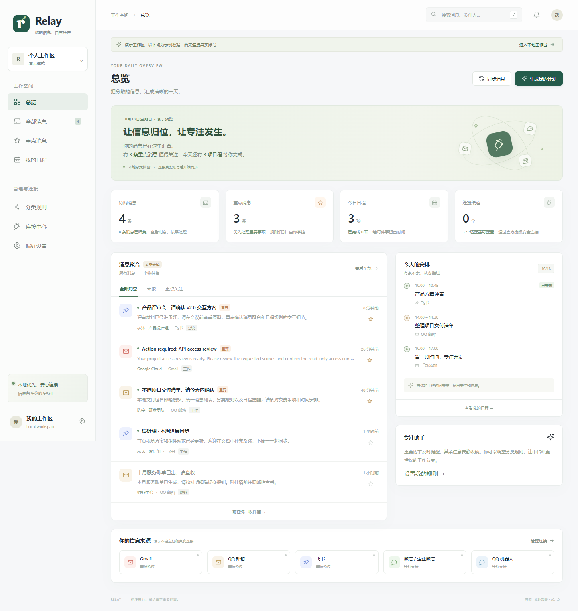

# Relay · 信息中转站

**把分散的消息汇到一处，把重要的事安排进日程。**

一个面向个人的开源、自托管信息中转站：聚合邮件与工作通知，本地规则分类，重点提醒，避开冲突的自动排程。基础功能由代码实现，不需要购买模型服务；可选连接兼容 Chat Completions 格式的 Agent API。



## 当前版本能做什么

这是可运行的 **v0.1 MVP**，适合个人本地部署和继续开发。页面中的演示账号和消息不会建立真实连接。

| 能力 | 实现状态 | 接入条件 / 边界 |
| --- | --- | --- |
| 中文界面、统一收件箱、搜索、来源筛选 | 已实现 | 桌面 / 手机适配；演示模式与真实工作区分离 |
| Gmail 收件箱 | 已实现适配器 | 用户自行创建 Google OAuth 应用；只读；每两分钟轮询 |
| QQ 邮箱 | 已实现适配器 | 专用授权码 + IMAP over TLS；不是 QQ 账号密码 |
| 飞书文本消息事件 | 已实现适配器 | 企业应用、事件订阅、平台权限、可达的 HTTPS 回调 |
| 个人微信全部聊天 | 不支持 | 不提供扫码接管、客户端抓取或个人聊天全量导出 |
| 企业微信应用消息 | 计划扩展 | 当前只提供统一消息模型和界面入口，尚无适配器 |
| QQ 官方机器人 | 计划扩展 | 当前只提供入口，尚无机器人适配器；能力取决于平台资质和权限 |
| 消息分类、重点标记、归档 | 已实现 | 本地关键词规则按顺序匹配，可编辑、启停、重新分类 |
| 自动生成个人计划 | 已实现 | 按优先级与手动截止时间安排；避开午休、非工作日、已有日程 |
| 自动保存新消息日程 | 可选启用 | 默认关闭；启用后后台每 15 秒检查待安排消息 |
| 提醒中心、浏览器通知 | 已实现 | 浏览器通知需用户允许且页面保持打开 |
| 飞书群提醒推送 | 已实现 | 独立配置群机器人 Webhook 和签名密钥；后台服务保持运行 |
| Agent 摘要与分类建议 | 已实现 | 默认关闭；仅对用户主动选中的消息发送正文片段；建议需确认应用 |
| 外部日历同步 | 未实现 | 支持导出带提醒的 `.ics` 日历文件供手动导入 |

第三方账号未在开发环境实际授权，适配器通过官方协议实现并使用模拟服务测试；不能把演示数据或通过测试理解为平台账号已接通。

## 快速开始

需要 **Python 3.11+**。前端是原生 HTML / CSS / JavaScript，不需要 Node.js，也没有 CDN、远程字体或统计脚本。

### Windows

在项目目录打开 PowerShell：

```powershell
powershell -ExecutionPolicy Bypass -File .\start.ps1
```

### macOS / Linux

```sh
sh start.sh
```

也可以手动安装：

```sh
python -m venv .venv
# Windows: .venv\Scripts\Activate.ps1
# macOS / Linux: . .venv/bin/activate
python -m pip install -r requirements.txt
python run.py
```

打开 **http://localhost:8765**。首次默认显示演示工作区；点击“进入本地工作区”，设置至少 12 位的管理密码。真实工作区初始为空，前往“连接中心”配置账号。

原生启动只监听 `127.0.0.1`。请使用 `localhost:8765` 访问，跨站来源校验与 `RELAY_ORIGIN` 必须一致。

### Docker 本地部署

```sh
cp .env.example .env
# 编辑 .env，设置 RELAY_ADMIN_PASSWORD，至少 12 位。
docker compose up -d --build
```

Windows 可使用 `Copy-Item .env.example .env`。默认只将端口发布到本机，数据库和加密密钥保存在 `relay-data` 命名卷。Docker 内的首次请求并非来自回环地址，因此必须通过环境变量设置初始密码。

停止：`docker compose down`。保留数据卷即可保留账号与提醒；`down -v` 会删除数据，谨慎使用。

原生启动**不会自动读取 `.env`**，请在终端设置环境变量后启动；Docker Compose 会读取 `.env`。

## 推荐使用流程

1. 解锁本地工作区，连接 Gmail、QQ 邮箱或飞书企业应用。
2. 设置分类关键词、工作时间、工作日、午休和免打扰时段。
3. 同步消息，查看重点内容；必要时手动填写截止时间。
4. 点击“生成我的计划”，预览后确认写入个人日程。
5. 启用浏览器通知，或配置独立的飞书群提醒。
6. 如需完全自动排程，在偏好设置中启用“自动安排新消息”。

自动排程把消息当作待处理任务，使用默认任务时长，不会自动理解会议的真实起止时间，也不会读取外部日历的忙闲信息。已读消息仍可能需要处理，故已读状态不会阻止排程；已归档、已安排、订阅和低优先级消息会跳过。未来 14 天没有空档时返回“未安排”，不强行越过截止时间。

## 授权接入

完整步骤见 [平台接入指南](docs/INTEGRATIONS.md)。

- Gmail：官方 OAuth 2.0 + PKCE + 会话绑定的单次 state，仅请求 `gmail.readonly`。Google 的测试用户、应用审核和受限权限要求由部署者处理。
- QQ 邮箱：QQ 邮箱专用授权码，固定连接 `imap.qq.com:993`，校验 TLS 证书，使用只读选箱和 `BODY.PEEK`，不修改原邮件状态。
- 飞书：只接收企业应用有权限收到的文本事件。要求 Encrypt Key 和 Verification Token，验证签名和时间戳后解密，按事件与消息 ID 去重。
- 断开连接会删除本地凭据，保留历史消息；平台侧授权或授权码请在对应平台撤销。

单个实例目前只支持 **一个管理员、每种渠道一个连接**。多用户隔离、多邮箱账号管理和企业 SSO 不在本版范围内。

## 可选 Agent API

通过服务端环境变量配置：

```powershell
$env:AGENT_BASE_URL = 'https://your-provider.example/v1'
$env:AGENT_API_KEY = '<由你本地设置，不要提交到仓库>'
$env:AGENT_MODEL = '<服务商提供的模型名称>'
python run.py
```

这是配置示例，示例域名和模型不是可用服务。接口会向 `${AGENT_BASE_URL}/chat/completions` 发起请求，需要支持 `response_format: {type: "json_object"}`。密钥不会发送给网页。

在偏好设置开启允许后，打开消息详情，点击“Agent 分析”。只发送该消息标题的前 500 字符和正文的前 6000 字符，返回摘要、分类与优先级建议；用户确认后才改变本地分类。没有模型工具调用、代码执行或由消息文本控制的外部操作。

当前复杂工作流可基于 `app/connectors.py` 中的适配器继续扩展。基础分类、计划生成、日程持久化与提醒均无需 Agent。

## 数据与安全设计

- 账号凭据、消息/日程内容、设置等用 Fernet 认证加密后写入 SQLite。消息 ID、来源、计划时间、提醒状态等索引保留明文。
- 原生数据默认位于项目下 `data/`；可使用 `RELAY_DATA_DIR` 指定独立目录。`vault.key` 与数据库分开保存，但同属本机，不能抵御整台设备被控制的情况。
- 管理密码使用带随机盐的 scrypt；会话令牌仅存在服务端内存，通过 HttpOnly、SameSite Cookie 传递；会话 12 小时失效，重启服务需重新登录。
- 写接口检查 Origin、自定义请求头与 CSRF Token；限制请求体大小、允许的 Host、登录尝试频率；界面不渲染外部消息 HTML，不加载邮件远程图片。
- 日程、提醒与推送重试记录持久化，服务重启后继续处理。邮箱每 120 秒轮询，排程与飞书推送每 15 秒检查。
- 飞书提醒是至少一次尝试的投递，超时场景可能重复送达；失败采用指数退避，最多 5 次。提醒中心保留未确认提醒，界面显示达到重试上限的数量。
- 免打扰期间暂缓提醒，结束后补发。手动已读或归档重点消息会确认其消息提醒。
- `.gitignore`、`.dockerignore` 排除数据、密钥、环境变量与虚拟环境；请勿手动把这些文件加入 Git。

**保持一个 Uvicorn 进程 / worker。** 多进程会重复启动轮询和推送任务，当前没有分布式任务锁。SQLite 支持单实例自托管，不是多租户云服务架构。远程部署须配置 HTTPS、正确的 `RELAY_ORIGIN`、安全 Cookie 和可信反向代理，详见接入指南。

备份时停止服务，备份整个数据目录（包括数据库、WAL 相关文件和原始密钥），并加密离线备份。丢失 `vault.key` 将无法解密数据，程序不会自动换钥掩盖错误。环境变量中的初始密码仅在首次初始化生效；本版尚无密码重置界面。

## 项目结构

```text
app/
  main.py          # 登录、API、OAuth、事件回调和后台工作循环
  store.py         # SQLite 与内容加密
  engine.py        # 本地分类、免打扰判断和无冲突排程
  connectors.py    # Gmail、QQ 邮箱、飞书与 Agent 适配器
static/            # 原生中文界面，无前端构建依赖
tests/             # 授权、加密、排程、连接器和投递测试
docs/              # 接入、架构和研究资料
compose.yaml       # 单实例 Docker 部署
```

详见 [架构与扩展](docs/ARCHITECTURE.md)。

## 测试

```sh
python -m pip install -r requirements-dev.txt
python -m pytest -q
```

可选使用 Node.js 检查前端语法：`node --check static/app.js`。GitHub Actions 在 Windows / Linux、Python 3.11 / 3.13 上执行测试，并验证 Docker 镜像启动。

## 已有工作与参考

[Huginn](https://github.com/huginn/huginn) 的事件流适合借鉴连接器编排；[Apprise](https://github.com/caronc/apprise) 适合后续扩展多渠道提醒；[Novu](https://github.com/novuhq/novu) 适合研究通知收件箱与工作流。它们不是本项目的运行依赖。本项目的界面、规则、排程和服务框架独立实现。

文档与许可证注意事项见 [调研记录](docs/RESEARCH.md)。

## 后续方向

- 企业微信官方应用适配器，QQ 官方机器人适配器。
- 多邮箱账号管理，OAuth 撤权 API，凭据和工作区密码管理界面。
- Gmail 增量 History / Pub/Sub、飞书长连接接收方式。
- 自然语言任务提取与复杂计划建议，外部日历忙闲同步。
- 独立任务队列、数据库迁移、重试管理和更多提醒渠道。

## License

[MIT](LICENSE)。第三方平台能力以官方文档、应用权限和用户授权为准。
